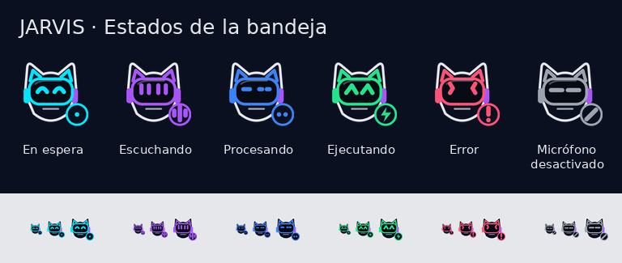

# Bandeja de JARVIS

El icono usa el visor, la capucha y los auriculares de la mascota como silueta. Tiene una variante estática por estado y mantiene el aspecto del panel principal. Los ICO incluyen 16, 24, 32, 48, 64, 128 y 256 píxeles. Los originales SVG están en [assets/tray](../assets/tray/).

| Estado | Expresión |
| --- | --- |
| En espera | Arcos relajados y un punto |
| Escuchando | Barras de escucha |
| Procesando | Puntos y líneas horizontales |
| Ejecutando | Ojos activos y un rayo |
| Error | Ángulos y signo de exclamación |
| Micrófono o escucha desactivados | Líneas planas y un símbolo de silencio |

El texto al pasar el ratón muestra el estado general. No incluye información de la orden, de la aplicación o de los perfiles de voz. En el menú puedes abrir JARVIS, controlar la escucha, configurar voz y permisos, buscar actualizaciones, reiniciar y salir completamente.

Cerrar el panel lo oculta y muestra un aviso de Windows la primera vez. **Salir completamente** termina el trabajo residente. Si abres otra copia, el mutex de Windows mantiene un único asistente y una sola sesión de micrófono. La candidata verifica la identidad del ejecutable en versiones publicadas conocidas, como 0.6.4.2. Si la anterior no reconoce la solicitud cooperativa, ciérrala desde su propia bandeja y pulsa **Reintentar**. Las versiones que sí la reconocen muestran la solicitud en la sesión anterior para que autorices su salida normal. La candidata espera a que se libere el mutex antes de arrancar.
